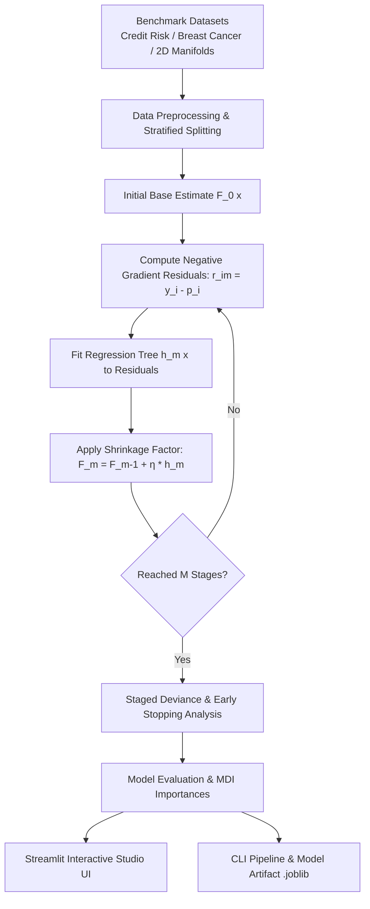

# Project 010: Gradient Boosting Algorithm Implementation & Studio

**Category:** Machine Learning - Basic Projects  
**Difficulty:** Beginner to Intermediate  
**Domain:** Foundational Machine Learning & Ensemble Methods  
**Tags:** `Beginner`, `gradient-boosting`, `ensemble`, `decision-trees`, `stochastic-boosting`, `streamlit`, `scikit-learn`

---

## 📖 Project Overview
This project delivers a production-grade **Gradient Boosting Machine (GBM) Studio** built with Python, Scikit-Learn, Plotly, and Streamlit. It explores the foundational mechanics of sequential additive modeling, where weak learners (shallow regression trees) are iteratively fitted to the negative gradients (pseudo-residuals) of a loss function under learning rate shrinkage.

The implementation includes:
- **Interactive Web Studio (`app.py`)**: Real-time hyperparameter tuning, stage-by-stage loss convergence tracking, early-stopping detection, 2D decision boundary visualization, individual tree stage inspection, and live inference sandboxing.
- **Production CLI Pipeline (`main.py`)**: Scriptable command-line interface with argument parsing, cross-validation, feature ranking, and model artifact serialization.
- **Core Engine (`gbm_engine.py`)**: Decoupled, modular machine learning library managing stage-by-stage metrics, MDI importances, and decision surfaces.
- **Dataset Benchmarks (`dataset.py`)**: Realistic tabular financial credit risk scoring, authentic benchmark datasets (Breast Cancer Wisconsin, Wine Cultivars), and 2D continuous geometric manifolds (Two Moons, Concentric Circles, Spirals).

---

## 📐 Mathematical Formulation

### 1. Additive Model Expansion
$$F_M(x) = F_0(x) + \sum_{m=1}^M \eta \cdot h_m(x)$$

Where:
- $F_0(x)$ is the base initial prediction (typically the log-odds for binary classification).
- $h_m(x)$ is the weak learner (regression tree) trained at stage $m$.
- $\eta \in (0, 1]$ is the **shrinkage factor (learning rate)** that regularizes each tree's update.
- $M$ is the total number of boosting stages (`n_estimators`).

### 2. Pseudo-Residuals as Negative Gradients
At each iteration $m$, pseudo-residuals $r_{im}$ represent the negative gradient of the loss function $L(y_i, F(x_i))$:
$$r_{im} = -\left[ \frac{\partial L(y_i, F(x_i))}{\partial F(x_i)} \right]_{F(x) = F_{m-1}(x)}$$

For binary classification using Bernoulli log-loss deviance:
$$r_{im} = y_i - p(x_i) \quad \text{where} \quad p(x_i) = \frac{1}{1 + e^{-F_{m-1}(x_i)}}$$
The algorithm fits a new regression tree $h_m(x)$ directly to these prediction errors $(y_i - p_i)$.

---

## 🏗️ Architecture & Pipeline Blueprint



---

## 🌟 Key Features

1. **Stage-by-Stage Deviance Convergence**:
   - Compares training vs testing deviance (log-loss) across all boosting iterations.
   - Automatically detects and highlights the **optimal early-stopping stage** ($\arg\min \text{Test Deviance}$).
2. **2D Continuous Decision Surface**:
   - Visualizes high-resolution probability landscapes and non-linear classification boundaries.
   - Overlays train/test data points and highlights misclassifications.
3. **Tree Architecture Diagnostics**:
   - Tracks average tree depth, terminal leaf counts, and total ensemble node complexity.
   - **Stage Inspector**: Inspects the exact regression tree fitted at stage $k$ and its split features.
4. **Mean Decrease in Impurity (MDI)**:
   - Ranks features by their cumulative contribution to reducing tree node impurity.
5. **Live Real-Time Inference Sandbox**:
   - Dynamic feature sliders for instant class probability estimation and confidence scores.
   - Batch CSV file upload and scoring with instant CSV download.
6. **Stratified K-Fold Cross-Validation**:
   - Assesses out-of-fold generalization stability (Accuracy, F1-Score, ROC-AUC).

---

## 📂 Project Structure

```
PROJECT_0010_gradient_boosting_algorithm_implementation/
│
├── app.py              # Flagship Streamlit interactive web studio
├── main.py             # Scriptable command-line runner and pipeline
├── gbm_engine.py       # Core Gradient Tree Boosting engine and analytics
├── dataset.py          # Benchmark dataset loader and 2D manifold generator
├── notebook.ipynb      # Interactive Jupyter exploration and walkthrough
├── requirements.txt    # Project dependencies
└── README.md           # Documentation and mathematical guide
```

---

## 🚀 Quickstart Guide

### 1. Environment Setup
```bash
# Optional: Create and activate virtual environment
python -m venv venv

# Windows:
.\venv\Scripts\activate
# macOS/Linux:
source venv/bin/activate

# Install dependencies
pip install -r requirements.txt
```

### 2. Launch the Interactive Web Studio (UI)
```bash
streamlit run app.py
```
Open your browser at `http://localhost:8501` to access the interactive Gradient Boosting Studio.

### 3. Run via Command Line Interface (CLI)
```bash
# Default run on Credit Default dataset
python main.py

# Custom hyperparameter run with 5-fold cross validation
python main.py --dataset credit --n-estimators 120 --learning-rate 0.05 --max-depth 4 --cv 5

# Benchmark on Breast Cancer with model saving
python main.py --dataset breast_cancer --n-estimators 100 --learning-rate 0.1 --save-model gbm_cancer.joblib

# 2D Geometric Manifold Benchmark
python main.py --dataset moons --n-estimators 80 --learning-rate 0.1
```

#### CLI Parameters:
- `--dataset`: `credit`, `breast_cancer`, `wine`, `moons`, `circles`, `blobs`, `spiral` (default: `credit`)
- `--n-estimators`: Number of boosting iterations / trees (default: `100`)
- `--learning-rate`: Shrinkage factor $\eta$ (default: `0.1`)
- `--max-depth`: Maximum individual tree depth (default: `3`)
- `--subsample`: Stochastic subsampling ratio (default: `1.0`)
- `--test-size`: Proportion of data held out for testing (default: `0.25`)
- `--cv`: Number of stratified cross-validation folds (default: `5`)
- `--save-model`: Optional file path to persist the trained model (`.joblib`)

---

## 📊 Comparison: Bagging vs. Boosting

| Dimension | Random Forest (Bagging) | Gradient Boosting (GBM) |
| :--- | :--- | :--- |
| **Ensemble Type** | Parallel independent trees | Sequential dependent trees |
| **Weak Learner** | Deep, unpruned decision trees | Shallow trees (stumps / depth 2-6) |
| **Optimization Target** | Original target labels $y$ | Pseudo-residuals $r_{im} = -\nabla L$ |
| **Error Reduction** | Primarily reduces **Variance** | Primarily reduces **Bias** |
| **Shrinkage ($\eta$)** | None (uniform voting) | Critical regularizer ($0.01 - 0.2$) |
| **Overfitting Risk** | Low (adding trees does not overfit) | Moderate (overfits if $M$ is too large without early stop) |

---

## 📈 Production Hardening Checklist
- [x] Decouple engine logic from UI presentation layers.
- [x] Implement stage-by-stage test deviance tracking to detect early-stopping points.
- [x] Support stochastic subsampling to increase computational speed and robustness.
- [x] Provide model serialization (`joblib`) for production deployment.
- [x] Validate cross-entropy loss and ROC-AUC under stratified K-Fold cross validation.

---

*Part of the 1,000 AI Projects Implementation Library.*
