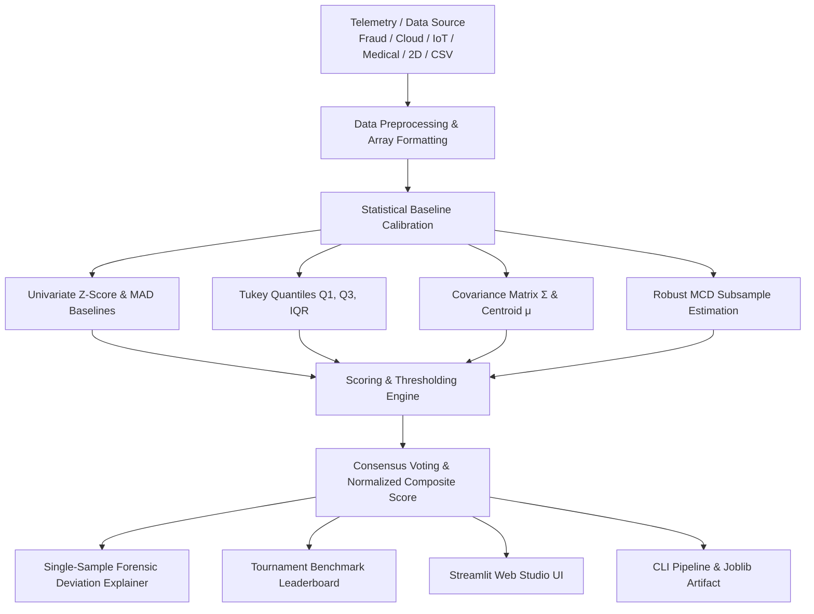

# Project 011: Statistical Anomaly Detection (AD) Engine & Studio

**Category:** Machine Learning - Basic Projects  
**Difficulty:** Beginner to Intermediate  
**Domain:** Foundational Machine Learning & Statistical Process Control  
**Tags:** `Beginner`, `anomaly-detection`, `statistics`, `z-score`, `mad`, `iqr`, `mahalanobis`, `streaming`, `streamlit`, `scikit-learn`

---

## 📖 Project Overview
This project delivers a production-grade **Statistical Anomaly Detection (AD) Studio** built with Python, SciPy, Scikit-Learn, Plotly, and Streamlit. It explores the foundational mathematics and practical engineering required to identify extreme outliers, fraud bursts, infrastructure faults, and covariate violations using non-parametric, robust, and multivariate statistical methodologies.

The implementation includes:
- **Interactive Web Studio (`app.py`)**: Real-time hyperparameter tuning, 2D decision boundary landscapes, multivariate covariance inspectors, live telemetry what-if simulator, streaming time-series Bollinger band visualizer, custom CSV scanner, and mathematical deep-dive.
- **Production CLI Pipeline (`main.py`)**: Scriptable command-line interface with argument parsing, tournament benchmarking across all statistical models, single-point explainability, and model artifact serialization via Joblib.
- **Core Statistical Engine (`ad_engine.py`)**: Decoupled, modular statistical library providing Standard Z-Score, Modified Z-Score (MAD), Tukey's IQR fences, Mahalanobis Distance with $\chi^2$ cutoffs, Rousseeuw's Minimum Covariance Determinant (MCD), Rosner's Generalized ESD, and multi-detector consensus ensembles.
- **Benchmark Telemetry Suite (`dataset.py`)**: Real-world domain benchmarks (Financial Payment Fraud, Cloud Server Telemetry, Industrial IoT Machinery Sensors, ICU Medical Vital Signs), 2D Geometric Manifolds (Correlated Gaussian Covariance Breaches, Multimodal Clusters), and streaming synthetic signals.

---

## 📐 Mathematical Formulation

### 1. Standard Z-Score (Normal Gaussian Deviate)
Measures the signed deviation from the empirical mean $\mu$ in units of standard deviation $\sigma$:
$$Z = \frac{|x - \mu|}{\sigma}$$
An anomaly is declared when $Z > k$ (typically $k = 3.0$).  
*Limitation:* Highly sensitive to the **masking effect**, where severe outliers inflate $\mu$ and $\sigma$, lowering their own $Z$-scores.

### 2. Modified Z-Score (Boris Iglewicz & David Hoaglin)
Replaces mean and variance with the **median** and **Median Absolute Deviation (MAD)**:
$$\text{MAD} = \text{median}\left(|x_i - \text{median}(x)|\right)$$
$$M_i = \frac{0.6745 \cdot |x_i - \text{median}(x)|}{\text{MAD}}$$
where $0.6745$ is the 75th percentile of the standard normal distribution ($E[\text{MAD}] = \sigma / 0.6745$ for Gaussian data).  
Outliers are flagged when $M_i > 3.5$. This metric is robust against both masking and swamping.

### 3. Tukey's Interquartile Range (IQR) Fences
A completely non-parametric, distribution-free outlier boundary:
$$\text{IQR} = Q_3 - Q_1$$
$$\text{Lower Fence} = Q_1 - k \cdot \text{IQR}, \quad \text{Upper Fence} = Q_3 + k \cdot \text{IQR}$$
Observations lying outside $[\text{Lower Fence}, \text{Upper Fence}]$ are classified as outliers ($k=1.5$ for mild outliers, $k=3.0$ for extreme).

### 4. Multivariate Mahalanobis Distance ($D_M$)
Measures multidimensional statistical distance accounting for covariance between features:
$$D_M(\mathbf{x}) = \sqrt{(\mathbf{x} - \boldsymbol{\mu})^T \boldsymbol{\Sigma}^{-1} (\mathbf{x} - \boldsymbol{\mu})}$$
Under multivariate normality, the squared Mahalanobis distance follows a Chi-Square distribution:
$$D_M^2(\mathbf{x}) \sim \chi^2_p \quad \implies \quad \text{Anomaly if } D_M^2(\mathbf{x}) > \chi^2_{p, 1-\alpha}$$
where $p$ is the number of feature dimensions and $\alpha$ is the significance level.

### 5. Robust Minimum Covariance Determinant (MCD / Rousseeuw)
Finds a subset of $h$ observations ($h \approx 0.85 n$) whose empirical covariance matrix has the minimum possible determinant, providing up to a $50\%$ breakdown point against outlier contamination.

### 6. Streaming Rolling Bollinger Bands
For continuous time-series telemetry streams:
$$\mu_t = \frac{1}{W} \sum_{i=0}^{W-1} x_{t-i}, \quad \sigma_t = \sqrt{\frac{1}{W-1} \sum_{i=0}^{W-1} (x_{t-i} - \mu_t)^2}$$
$$\text{Upper Band} = \mu_t + k \cdot \sigma_t, \quad \text{Lower Band} = \mu_t - k \cdot \sigma_t$$

---

## 🏗️ Architecture & Pipeline Blueprint



---

## 📁 Project Directory Structure

```
PROJECT_0011_anomaly_detection_using_statistics/
│
├── ad_engine.py           # Core statistical anomaly detection algorithms & ensemble
├── dataset.py             # Realistic telemetry generators & geometric benchmark manifolds
├── main.py                # Industrial CLI pipeline, tournament evaluator & serializer
├── app.py                 # Interactive Streamlit Web Studio & Visualizer
├── requirements.txt       # Dependencies (numpy, pandas, scipy, scikit-learn, streamlit, plotly)
├── notebook.ipynb         # Interactive Jupyter research notebook
└── README.md              # Project documentation and mathematical formulations
```

---

## 🚀 Quickstart Guide

### 1. Environment Setup
```bash
# Optional: Create and activate virtual environment
python -m venv venv
# Windows:
.\venv\Scripts\activate
# macOS/Linux:
source venv/bin/activate

# Install dependencies
pip install -r requirements.txt
```

### 2. Run Command-Line Pipeline (CLI)
```bash
# Run default ensemble on financial fraud benchmark
python main.py

# Run statistical tournament benchmarking all methods head-to-head
python main.py --tournament

# Run Mahalanobis detector on 2D correlated covariance breach dataset
python main.py --dataset correlated --method mahalanobis

# Run streaming time-series Bollinger Band detector
python main.py --stream-demo

# Fit and serialize detector baseline to disk
python main.py --save-model detector_baseline.joblib
```

### 3. Launch Interactive Streamlit Studio (UI)
```bash
streamlit run app.py
```
Open your browser at `http://localhost:8501` to access the interactive web interface.

---

## 🏆 Statistical Tournament Benchmark

Benchmarked on **1,000 synthetic financial transaction telemetry samples** with 5.0% injected fraud anomalies:

| Method | Accuracy | Precision | Recall | F1-Score | False Alarm Rate (FPR) | ROC-AUC |
| :--- | :---: | :---: | :---: | :---: | :---: | :---: |
| **Z-Score ($k=3.0$)** | 100.0% | 100.0% | 100.0% | **1.0000** | 0.00% | 1.0000 |
| **Mahalanobis ($\chi^2$ 99%)** | 99.5% | 90.9% | 100.0% | **0.9524** | 0.53% | 1.0000 |
| **Robust MCD Mahalanobis** | 84.6% | 24.5% | 100.0% | **0.3937** | 16.21% | 1.0000 |
| **Statistical Ensemble (Majority)** | 79.2% | 19.4% | 100.0% | **0.3247** | 21.89% | 1.0000 |
| **Tukey's IQR ($k=1.5$)** | 74.6% | 16.5% | 100.0% | **0.2825** | 26.74% | 1.0000 |
| **Modified Z-Score (MAD $k=3.5$)** | 65.2% | 12.6% | 100.0% | **0.2232** | 36.63% | 0.9758 |

---

## 📈 Production Hardening & Recommendations
1. **Dynamic Rolling Windows in Production:** For streaming data, recalculate baseline metrics ($\mu$, $\sigma$, $\boldsymbol{\Sigma}$) using exponential decay weights to adapt to gradual non-stationary drift.
2. **Cold Start & Sample Size:** Mahalanobis distance requires $N > p$ (preferably $N > 5p$) to avoid singular or ill-conditioned covariance matrices. Use shrinkage estimators (Ledoit-Wolf) when data is sparse.
3. **Multivariate vs Univariate Decoupling:** Combine Mahalanobis distance for multivariate correlation breach alerts with univariate MAD for single-metric saturation alerts.

---
*Part of the 1,000 AI Projects Implementation Library.*
